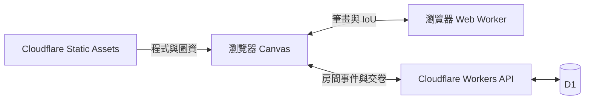

# 架構

| 入口 | 職責 |
| --- | --- |
| `public/app.js`、`map.js` | 畫面、圈選與地圖操作 |
| `public/solo-game.js`、`solo-engine.js`、`solo-worker.js` | 單人狀態與瀏覽器計分 |
| `public/multi-client.js` | 多人預載、交卷、重連與揭曉 |
| `shared/scoring.js`、`rules.js` | IoU、遊戲規則與排名 |
| `server/free-rooms.js`、`free-schema.sql` | 房間、玩家與逐題收件 |
| `scripts/build-static.js`、`build-cloudflare.js` | 靜態圖資分包與 Worker 打包 |

單人與多人都在瀏覽器計分。多人作答期間不做背景輪詢，全員交件後揭曉，由房主進入下一題。D1 保留房間狀態、成績與當題筆跡。
